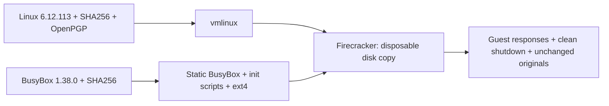

# From source code to the first boot

[Português](build-from-source.md) · [README](../README.en.md)

This stage removes the dependency on the previously prepared Ubuntu kernel and disk. The recipe compiles Linux and BusyBox and creates a new ext4 image with init, console and shutdown defined in this repository. The earlier artifacts remain preserved.



## Pins and verification

The [source lock file](../config/sources.lock.json) pins URLs, versions and SHA256 hashes:

| Component | Version | Verification |
| --- | --- | --- |
| Linux | 6.12.113 | Compressed archive SHA256 and detached signature over the uncompressed TAR, using Greg Kroah-Hartman's pinned fingerprint. |
| BusyBox | 1.38.0 | Pinned SHA256 from the project's official HTTPS checksum. The Buildroot mirror is accepted only if it produces the same hash. |
| Lab rootfs | Local recipe | Static BusyBox, versioned scripts, 128 MiB ext4 and a VM configuration with 2 vCPUs and 256 MiB. |

The kernel public key was obtained through kernel.org's WKD and its fingerprint compared with the [official signature page](https://www.kernel.org/signature.html). A reviewed copy lives under `config/keys/`; verification requires that key and fingerprint. GPG's trust warning is not suppressed: the recipe's trust anchor is the explicit fingerprint comparison, rather than the user's personal web of trust.

BusyBox verification does not provide the same signature guarantee as the kernel: initial trust comes from official HTTPS and the reviewed checksum. We do not claim OpenPGP authentication for it. The pinned SHA256 prevents accepting a different file after that choice.

Configuration fragments are versioned too. The build checks that every requested option actually took effect, including virtio-blk/MMIO, ext4, serial console and static BusyBox. A missing option stops the process before an artifact is declared ready.

## Prepare the host

Use Linux x86-64, Python 3.12 or newer, and a directory on the Linux filesystem without spaces. Install GCC and static libc, binutils, make, bison, flex, m4, bc, OpenSSL/libelf headers, pkg-config, fakeroot, e2fsprogs, xz, bzip2 and GnuPG. Common Ubuntu packages are:

```bash
sudo apt-get install build-essential bison flex m4 bc libssl-dev libelf-dev \
  pkg-config fakeroot e2fsprogs xz-utils bzip2 gnupg python3
```

That installation command is guidance for another host; this test did not install packages globally. Missing tools were downloaded through APT and extracted into a user directory without sudo. Evidence records the versions used. The normal build runs without root; `fakeroot` supplies the root ownership view when creating the image.

Allow roughly 4 GiB per build tree plus space for boot runs. The recipe caps parallelism at four jobs for this lab.

## Build in a new directory

From the repository root:

```bash
python3 scripts/build_artifacts.py \
  --work-dir "$HOME/fc-build/run-01" \
  --cache-dir "$HOME/fc-build/downloads" \
  --jobs 4
```

`run-01` must not already exist. The cache can be reused, but every file's hash is checked again. A modified cache file causes failure; the recipe does not silently replace a suspicious file. No source is extracted before verification.

Outputs live under `run-01/artifacts/`: `vmlinux`, `rootfs.ext4`, `vm-config.json`, `kernel.config` and `busybox.config`. `build-result.json` records the stage, sources, artifact hashes and tools; `build.log` and `kernel-signature.status` retain diagnostics. Failure leaves the report failed and does not start a VM.

To check sources only, choose another new directory and add `--verify-only`. This verifies files and the signature without compiling.

## Boot the newly built artifacts

Firecracker remains the local v1.17.0 binary used in the earlier stage. This recipe builds the kernel and rootfs, not the VMM.

```bash
python3 -m unittest discover -s tests -v

python3 scripts/boot_check.py \
  --firecracker "$HOME/fc-lab/firecracker" \
  --kernel "$HOME/fc-build/run-01/artifacts/vmlinux" \
  --rootfs "$HOME/fc-build/run-01/artifacts/rootfs.ext4" \
  --config "$HOME/fc-build/run-01/artifacts/vm-config.json" \
  --output-parent "$HOME/fc-lab"
```

The controller still creates a fresh copy for every boot. The minimal image does not include util-linux: it reads `/proc/mounts`, `/proc/self/mountinfo` and `/sys/class/block/vda/dev` when `findmnt` is absent. If the source is `/dev/root`, it requires the root mount's major:minor identifier to match `vda`. The alias alone is not accepted.

PID 1 is BusyBox init. The console starts a local root shell directly, without a password; the account password is locked and there is no SSH or networking. `SendCtrlAltDel` invokes a script that syncs the disk, remounts root read-only and requests reboot. The test requires guest responses, HTTP 204, exit zero and unchanged originals.

## A real failure that changed the configuration

The first build reached the shell and confirmed the ext4 root, but did not shut down after `SendCtrlAltDel`. The API returned 204 and the process had to be terminated after the deadline. The test remained failed, with `forced_stop: true` and exit `-15`; original artifacts remained unchanged.

That kernel lacked INPUT, SERIO and VT. The [Firecracker v1.17.0 implementation](https://github.com/firecracker-microvm/firecracker/blob/v1.17.0/src/vmm/src/rpc_interface.rs) explains that this action injects keystrokes through i8042 and depends on an AT driver inside the guest. We added those options, the AT driver and virtual console to the required fragment. New boot and shutdown runs verify the correction; the acceptance criterion still requires more than HTTP 204.

## Results from this run

| Attempt | Guest response | Shutdown | Outcome |
| --- | --- | --- | --- |
| Initial kernel, without AT/i8042 | New kernel and ext4 root confirmed | HTTP 204 but no shutdown; process terminated with `-15` after the deadline | Failed |
| Corrected kernel, boot 1 | New kernel and root device confirmed | Root remounted read-only, HTTP 204 and exit 0 | Passed |
| Corrected kernel, boot 2 | Fresh copy of the same disk, responses confirmed | Root remounted read-only, HTTP 204 and exit 0 | Passed |

Artifact hashes remained unchanged in all three attempts. The four earlier Ubuntu artifacts were checked and preserved too. All ten regressions passed, and a modified source archive was rejected before extraction or compilation. BusyBox was extracted from ext4 for inspection: it matches the compiled binary, is static and belongs to UID/GID 0.

## Reproduction scope

Source versions, hashes, configurations and scripts are pinned. Host tool versions are recorded but not packaged into a hermetic toolchain. Static libc comes from the host. Timestamps, ext4 metadata and compiler versions may change output hashes. We do not promise byte-for-byte identical images across hosts.

The first image's console also reported `Spectre V2 : User space: Vulnerable`, `Speculative Store Bypass: Vulnerable`, I/O accesses outside emulated ranges and no PMU driver. These findings remain in the evidence. The minimal boot profile still needs a separate hardening stage before third-party workloads; this exercise does not validate those mitigations.

The minimal guest is not a production distribution or an update of the old Ubuntu image. Kernel 6.12.113 is this exercise's locally validated choice; we do not claim certification by Firecracker's support matrix. Networking, SSH and `jailer` remain outside this stage.

Real results and preparation issues are recorded in the [build evidence](../evidence/source-build-results.json). The repository contains code, configuration and reviewed evidence; downloaded sources, compiled kernels, images, private keys and raw consoles remain outside Git.
