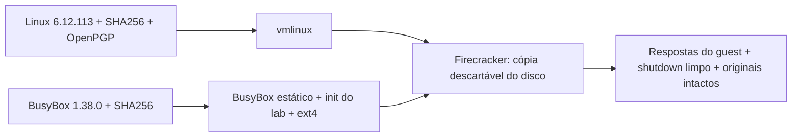

# Do código-fonte ao primeiro boot

[English](build-from-source.en.md) · [README](../README.md)

Nesta etapa deixamos de depender do kernel e do disco Ubuntu preparados anteriormente. A receita compila Linux e BusyBox e monta uma imagem ext4 nova, com init, console e encerramento definidos neste repositório. Os artefatos anteriores ficam preservados.



## O que está fixado e como verificamos

O [manifesto de fontes](../config/sources.lock.json) fixa URLs, versões e SHA256:

| Componente | Versão | Verificação |
| --- | --- | --- |
| Linux | 6.12.113 | SHA256 do arquivo comprimido e assinatura destacada do TAR descomprimido, com fingerprint fixado de Greg Kroah-Hartman. |
| BusyBox | 1.38.0 | SHA256 fixado a partir do checksum publicado por HTTPS pelo projeto. O mirror Buildroot só é aceito se produzir o mesmo hash. |
| Rootfs do lab | Receita local | BusyBox estático, scripts versionados, ext4 de 128 MiB e configuração da VM com 2 vCPUs e 256 MiB. |

A chave pública do kernel foi obtida pelo WKD de kernel.org e seu fingerprint foi comparado com a [página oficial de assinaturas](https://www.kernel.org/signature.html). A cópia revisada fica em `config/keys/`; o verificador exige essa chave e esse fingerprint. O aviso de confiança do GPG não é suprimido: a âncora usada pela receita é a comparação explícita do fingerprint, não a rede pessoal de confiança do usuário.

A verificação do BusyBox não tem a mesma garantia de assinatura do kernel: a confiança inicial vem do HTTPS oficial e do checksum revisado. Não declaramos autenticação OpenPGP para ele. O SHA256 fixado impede aceitar um arquivo diferente depois dessa escolha.

Os fragmentos de configuração também ficam no Git. O build confere se todas as opções pedidas foram realmente aplicadas; isso inclui virtio-blk/MMIO, ext4, console serial e BusyBox estático. Uma opção ausente faz o processo parar antes de gerar um artefato declarado pronto.

## Preparar o host

Use Linux x86-64, Python 3.12 ou mais recente e um diretório no filesystem Linux sem espaços. Tenha GCC e libc estática, binutils, make, bison, flex, m4, bc, headers de OpenSSL/libelf, pkg-config, fakeroot, e2fsprogs, xz, bzip2 e GnuPG. Em Ubuntu, os pacotes usuais são:

```bash
sudo apt-get install build-essential bison flex m4 bc libssl-dev libelf-dev \
  pkg-config fakeroot e2fsprogs xz-utils bzip2 gnupg python3
```

Esse comando de instalação é uma orientação para preparar outro host; o teste aqui não instalou pacotes globalmente. As ferramentas que faltavam foram baixadas pelo APT e extraídas em um diretório do usuário, sem sudo. As versões usadas ficam nas evidências. O build normal roda sem root; `fakeroot` fornece a visão de proprietário root ao criar a imagem.

Reserve cerca de 4 GiB por árvore de build e espaço extra para os boots. A receita limita o paralelismo a quatro processos para este lab.

## Construir em um diretório novo

Na raiz do repositório:

```bash
python3 scripts/build_artifacts.py \
  --work-dir "$HOME/fc-build/run-01" \
  --cache-dir "$HOME/fc-build/downloads" \
  --jobs 4
```

`run-01` ainda não pode existir. O cache pode ser reutilizado, mas todo arquivo passa novamente pela checagem do hash. Um cache alterado causa falha; a receita não substitui silenciosamente o arquivo suspeito. Nenhum fonte é extraído antes das verificações.

O resultado fica em `run-01/artifacts/`: `vmlinux`, `rootfs.ext4`, `vm-config.json`, `kernel.config` e `busybox.config`. `build-result.json` registra o estágio, fontes, hashes dos artefatos e ferramentas; `build.log` e `kernel-signature.status` guardam o diagnóstico. Uma falha mantém o relatório reprovado e não inicia uma VM.

Para conferir apenas as fontes, use outro diretório novo e acrescente `--verify-only`. Isso valida os arquivos e a assinatura, sem compilar.

## Testar o boot dos artefatos construídos

O Firecracker usado continua sendo o binário local v1.17.0 da etapa anterior. Esta receita constrói o kernel e o rootfs, não o VMM.

```bash
python3 -m unittest discover -s tests -v

python3 scripts/boot_check.py \
  --firecracker "$HOME/fc-lab/firecracker" \
  --kernel "$HOME/fc-build/run-01/artifacts/vmlinux" \
  --rootfs "$HOME/fc-build/run-01/artifacts/rootfs.ext4" \
  --config "$HOME/fc-build/run-01/artifacts/vm-config.json" \
  --output-parent "$HOME/fc-lab"
```

O controlador continua criando uma cópia nova para cada boot. A imagem mínima não inclui util-linux: ele consulta `/proc/mounts`, `/proc/self/mountinfo` e `/sys/class/block/vda/dev` quando `findmnt` não existe. Se a origem aparecer como `/dev/root`, exige que o identificador major:minor do root corresponda ao de `vda`. Não aceita esse alias só pelo nome.

O PID 1 é o init do BusyBox. O console abre diretamente um shell root local, sem senha; a senha do usuário fica bloqueada e não há SSH nem rede. `SendCtrlAltDel` chama um script que sincroniza o disco, remonta o root somente para leitura e pede reboot. O teste exige a resposta do guest, HTTP 204, saída zero e preservação dos originais.

## Uma falha real que mudou a configuração

A primeira construção chegou ao shell e comprovou o root ext4, mas não encerrou após `SendCtrlAltDel`. A API respondeu 204 e o processo precisou ser terminado depois do prazo. O teste ficou reprovado, com `forced_stop: true` e saída `-15`; os originais permaneceram intactos.

O kernel estava sem INPUT, SERIO e VT. A [implementação do Firecracker v1.17.0](https://github.com/firecracker-microvm/firecracker/blob/v1.17.0/src/vmm/src/rpc_interface.rs) explica que essa ação injeta teclas via i8042 e depende de um driver AT no guest. Acrescentamos essas opções, o driver AT e o console virtual ao fragmento obrigatório. A correção é conferida por novos boots e encerramentos; não trocamos o critério por apenas aceitar HTTP 204.

## Resultados desta execução

| Tentativa | Resposta do guest | Encerramento | Resultado |
| --- | --- | --- | --- |
| Kernel inicial, sem AT/i8042 | Kernel novo e root ext4 confirmados | HTTP 204, mas sem shutdown; processo terminado com `-15` após o prazo | Reprovado |
| Kernel corrigido, boot 1 | Kernel novo e dispositivo do root confirmados | Root remontado somente para leitura, HTTP 204 e saída 0 | Aprovado |
| Kernel corrigido, boot 2 | Outra cópia do mesmo disco, respostas confirmadas | Root remontado somente para leitura, HTTP 204 e saída 0 | Aprovado |

Os hashes dos artefatos usados ficaram intactos nas três tentativas. Os quatro artefatos Ubuntu anteriores também foram conferidos e preservados. Os dez testes de regressão passaram, e um arquivo de fonte alterado foi rejeitado antes de extrair ou compilar. O BusyBox dentro do ext4 foi extraído para conferência: coincide com o binário compilado, é estático e pertence a UID/GID 0.

## Alcance da reprodução

As versões dos fontes, hashes, configurações e scripts estão fixados. As versões das ferramentas do host são registradas, mas não estão encapsuladas em um toolchain hermético. A libc estática vem do host. Timestamps, metadados do ext4 e versões do compilador podem mudar os hashes de saída. Não prometemos imagens idênticas byte a byte em hosts diferentes.

O console da primeira imagem também reportou `Spectre V2 : User space: Vulnerable`, `Speculative Store Bypass: Vulnerable`, acessos a portas de I/O sem faixa emulada e ausência de driver de PMU. Esses achados ficam nas evidências. O perfil mínimo de boot ainda precisa de uma etapa própria de hardening antes de workloads de terceiros; este exercício não valida essas mitigações.

O guest mínimo não é uma distribuição pronta para produção, nem uma atualização do antigo Ubuntu. O kernel 6.12.113 é uma escolha deste exercício, validada localmente; não declaramos certificação pela matriz de suporte do Firecracker. Rede, SSH e `jailer` continuam fora desta etapa.

Os resultados reais e os problemas encontrados durante a preparação ficam no [registro desta construção](../evidence/source-build-results.json). O repositório recebe código, configurações e evidências revisadas; fontes baixados, kernels compilados, imagens, chaves privadas e consoles brutos ficam fora do Git.
