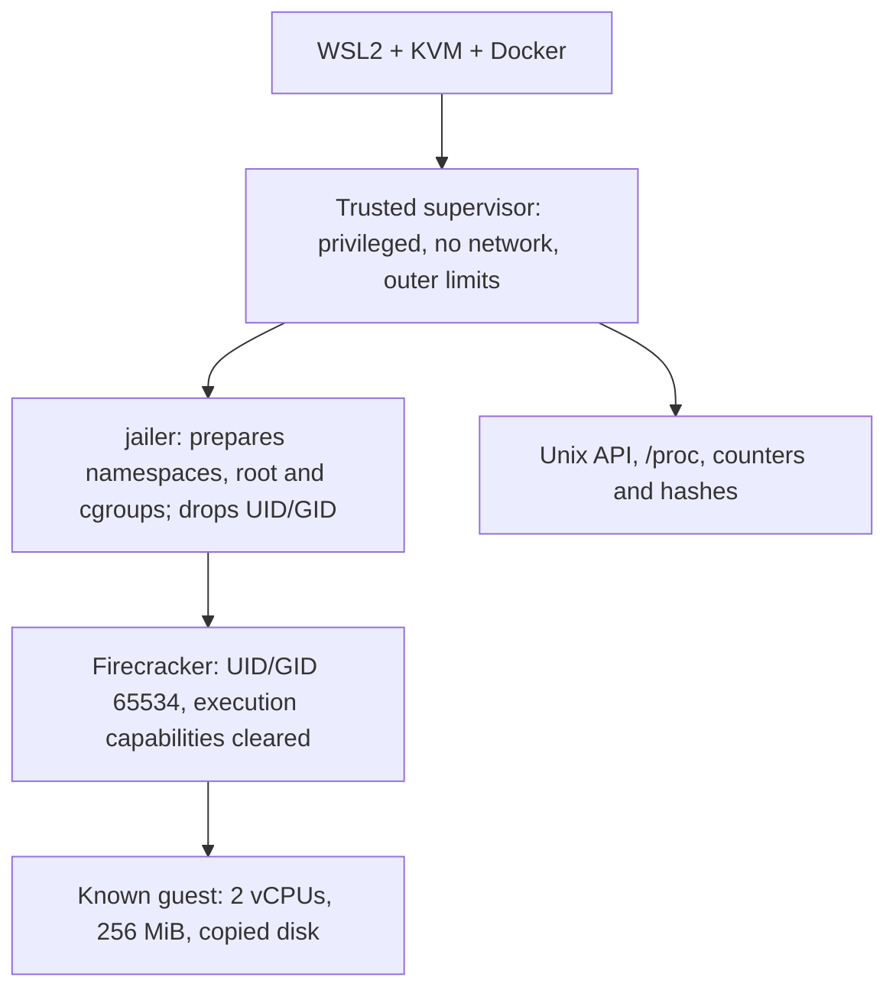

# First jailer tests

[Português](jailer.md) · [README](../README.en.md) · [Evidence](../evidence/jailer-results.json)

Boot already worked with the kernel and image built in the lab. This stage puts Firecracker inside the `jailer` and inspects the process from outside: credentials, namespaces, filesystem root, filters and resource limits. Failure controls check whether an incomplete profile is actually rejected.

## How we ran it

The WSL user does not have passwordless sudo. A direct attempt failed with `Operation not permitted` while changing executable ownership. To prepare namespaces, devices and cgroups, we used a **privileged** helper container without external networking, with a private cgroup namespace and outer limits of 2 CPUs, 768 MiB and 256 tasks. The Python image digest and hashes of the static Firecracker/jailer v1.17.0 pair are in the [profile](../config/jailer-profile.json). Binary hashes match the local distribution manifest; this does not independently authenticate that manifest's origin.

This container is a trusted part of the test with administrative powers over the shared host kernel. The evaluated boundary is the jailer's child process. Using this helper does not demonstrate a secure service for untrusted users and is not a production deployment recommendation.

The wrapper mounts only the two binaries and selected kernel/disk read-only, test scripts and a new output directory. It does not mount the entire lab directory containing keys or the Docker socket inside the container. Each scenario gives the jailer a fresh disk copy.



## Repeat locally

Prepare artifacts using the [build guide](build-from-source.en.md). Use a matching static binary pair and Docker with KVM access and cgroup v2 support. This recipe ran on Ubuntu 26.04.1/WSL2; it needs preparation privileges and does not grant sudo or change global host permissions.

```bash
python3 -m unittest discover -s tests -v

python3 scripts/run_jailer_lab.py \
  --binary-dir "$HOME/fc-lab" \
  --artifacts "$HOME/fc-build/run-01/artifacts" \
  --output-parent "$HOME/fc-lab"
```

The binary directory needs `firecracker` and `jailer`; the artifact directory needs `vmlinux` and `rootfs.ext4`. Replace `run-01` with your build. The profile requires the binary hashes reviewed in this stage. Docker may fetch the helper image by digest if it is not cached.

Each run creates a unique `jailer-*` directory containing script/profile snapshots, `launch.json`, suite and scenario reports, consoles and disk copies. Exit `0` means expected outcomes were checked; **it does not mean every VM ended successfully**. OOM and deadline controls must end the VM with SIGKILL. Unexpected failures leave the suite failed. An outer 180-second watchdog exists; the one-second control below tests stopping a VM, not that outer watchdog.

## Observed isolation

| Check | Observation |
| --- | --- |
| Credentials | Real, effective, saved and filesystem UID/GID are 65534, with no supplementary root group. Guest root is distinct from these VMM credentials. |
| Capabilities | `CapEff`, `CapPrm`, `CapInh` and `CapAmb` are zero in every observed thread. `CapBnd` remains broad, inherited from the helper; we do not claim every mask is cleared. |
| Future privileges | The supervisor sets `no_new_privs` before invoking the jailer. Observed value is 1 before and after boot. |
| Seccomp | The API thread is filtered before boot. The main thread installs its filter during `InstanceStart`; after the guest responds, every observed thread has `Seccomp: 2`. This establishes installation, not policy completeness. |
| Namespaces | Mount, PID and network differ from the supervisor; the VMM is PID 1 in its new namespace. A separate network namespace with loopback only is supplied to the jailer by the test. |
| Shared namespaces | UTS, IPC, user and cgroup remain shared with the helper. The jailer did not add new isolation for those four types in this profile. |
| Filesystem | Device/inode of `/proc/<pid>/root` match the jail root. API attempts to open the outside kernel, traverse `..` or write an outside canary receive ENOENT; the canary remains unchanged. |
| Inheritance | A deliberately passed environment variable and file descriptor canary do not appear in the VMM. Descriptors 0/1/2 remain connected to the test console. |

The network namespace is reused across the suite's sequential scenarios; network isolation between simultaneous VMs was not tested.

The jail root and working files are not an immutable image. The operator and supplied resources remain trusted. Path tests check the jail boundary within the helper; they are not a hypervisor or host-kernel escape test.

## Resources: configure, then try to exceed them

| Resource | Profile and real test |
| --- | --- |
| CPU | `cpu.max=50000 100000` while running: a half-CPU ceiling despite two virtual vCPUs. Two guest loops increase `nr_throttled`. The actual quota is checked in the VM cgroup. |
| Shutdown | Before Ctrl+Alt+Del, the ceiling becomes `200000 100000`, still inside the 2-CPU outer cap. This enlarges the budget; it does not reserve exclusive CPUs or guarantee scheduling under every host load. |
| Memory | Normal VMM profile: 384 MiB, no swap. The control uses 96 MiB for a guest configured with 256 MiB; guest allocation triggers `oom_kill` and SIGKILL for that VMM. `memory.peak` records 96 MiB. |
| Tasks | `pids.max=32`. A trusted helper outside the jail, moved into the same cgroup, tries to create 48 threads. Creation is blocked and `pids.events:max` increases. This counts host tasks, not processes inside the guest. |
| Descriptors | Normal `RLIMIT_NOFILE=64`. At 16, real backing-file opens through the API receive error 24. This control does not start a guest and is stopped during cleanup. |
| Deadline | A known guest starts and the supervisor stops it after a one-second budget. The test requires SIGKILL and records elapsed time; it is not labeled clean shutdown. |

The supervisor has its own cgroup; the thread helper enters the VM leaf only for the `pids.max` test. Disk copying and some file cache are charged to the supervisor, so the VMM leaf's measurement is not total environment memory. Outer limits cover the whole environment.

## Results and retained failures

The final profile passed **two complete runs of six scenarios**. In each, baseline and repeat booted and shut down cleanly. The `--no-seccomp` control started only the known guest and was detected as an unapproved profile; it then shut down normally. Other controls confirmed descriptor rejection, OOM and deadline enforcement. All **15 regressions** passed.

We do not add these checks to earlier stages as a cumulative score. The [reviewed reports](../evidence/jailer-results.json) distinguish suite acceptance, profile approval and process outcome. Intermediate failures stay failed in the [investigation history](../evidence/jailer-investigation.json):

- Permission failure when running directly without root.
- A premature seccomp check before the VMM installed the main-thread filter. Checks now distinguish preboot and running phases; the disabled-seccomp control verifies rejection after boot.
- HTTP client timeout while waiting for EOF on a persistent connection, despite receiving HTTP 400. The client now respects `Content-Length`; a regression keeps the connection open to test that case.
- One run under a half-CPU quota reached shutdown, but Firecracker reported `Timed out waiting for vCPU thread 'fc_vcpu 0' to exit` and exited with **SIGSEGV (-11)**. No OOM occurred in that case. Another run had already succeeded at that quota, so we do not assign a definitive cause to the CPU ceiling. The final profile waits for load workers to stop and raises the quota only for shutdown. Both repeat runs passed; the panic remains an open finding without a claim of elimination.

## Remaining work

Console findings for Spectre V2/Speculative Store Bypass, I/O and PMU remain. Kernel and guest were not rebuilt to fix those in this stage. Remaining work includes narrower bootstrap privileges/delegation, `CapBnd` review, seccomp policy evaluation, root-console hardening, guest networking/SSH/egress and testing on a dedicated environment. I/O limits and `RLIMIT_FSIZE` were not tested. Toolchain and BusyBox origin verification retain the build guide's limitations.

Cgroup leaves and the helper are removed after processes stop, including controls. Generated device nodes are removed from the test copies. Disks, script snapshots and raw logs remain local for inspection; only reviewed summaries and a fixture enter Git. Hashes of all four inputs remained unchanged. The outer container had no local OOM, although its hierarchical counters include the expected child OOM.

These are local tests with known tasks. They do not establish safe execution of arbitrary untrusted code and did not run in GitHub Actions. Implementation and validation were assistant-assisted.

References: [jailer v1.17.0](https://github.com/firecracker-microvm/firecracker/blob/v1.17.0/docs/jailer.md), [host preparation](https://github.com/firecracker-microvm/firecracker/blob/v1.17.0/docs/prod-host-setup.md) and [vCPU exit wait](https://github.com/firecracker-microvm/firecracker/blob/v1.17.0/src/vmm/src/vstate/vcpu.rs).

The follow-up separates the vCPU timeout from the later SIGSEGV, tests CPU quota and compares a candidate with a five-second internal timeout. The historical trigger remains unresolved. [Analysis and repetitions under load](shutdown-investigation.en.md).
