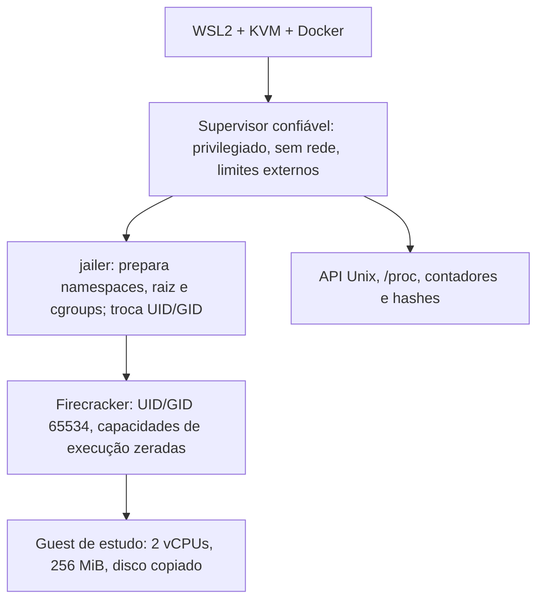

# Primeiros testes com o jailer

[English](jailer.en.md) · [README](../README.md) · [Evidências](../evidence/jailer-results.json)

O boot já funcionava com o kernel e a imagem construídos no lab. Nesta etapa colocamos o Firecracker dentro do `jailer` e verificamos o processo por fora: credenciais, namespaces, raiz do filesystem, filtros e limites de recursos. Também provocamos falhas para conferir se o teste realmente reprova um perfil incompleto.

## Como executamos

O usuário do WSL não tem sudo sem senha. A tentativa direta falhou com `Operation not permitted` ao trocar o proprietário do executável. Para preparar namespaces, dispositivos e cgroups, usamos um contêiner auxiliar **privilegiado**, sem rede externa, com cgroup namespace privado e limites de 2 CPUs, 768 MiB e 256 tarefas. O digest da imagem Python e os hashes do par estático Firecracker/jailer v1.17.0 ficam no [perfil](../config/jailer-profile.json). Os hashes dos binários conferem com o manifesto local da distribuição; isso não adiciona autenticação independente à origem desse manifesto.

Esse contêiner é parte confiável do teste e tem poderes administrativos no kernel compartilhado com o host. A barreira avaliada é o processo filho do jailer. O uso desse auxiliar não demonstra um serviço seguro para usuários não confiáveis e não é uma recomendação de implantação em produção.

O wrapper monta somente os dois binários e o kernel/disco escolhidos, como leitura, os scripts de teste e um diretório novo de saída. Não monta a pasta inteira com chaves do lab nem o socket Docker dentro do contêiner. O jailer recebe uma cópia nova do disco em cada cenário.



## Repetir no ambiente local

Prepare antes os artefatos pelo [guia de construção](build-from-source.md). Use o par estático de binários da mesma versão e tenha Docker com acesso ao KVM e suporte a cgroup v2. Esta receita foi exercitada em Ubuntu 26.04.1/WSL2; ela exige privilégios de preparação e não tenta conceder sudo ou alterar permissões globais do host.

```bash
python3 -m unittest discover -s tests -v

python3 scripts/run_jailer_lab.py \
  --binary-dir "$HOME/fc-lab" \
  --artifacts "$HOME/fc-build/run-01/artifacts" \
  --output-parent "$HOME/fc-lab"
```

O diretório de binários precisa conter `firecracker` e `jailer`; o de artefatos, `vmlinux` e `rootfs.ext4`. Ajuste `run-01` para o build escolhido. O perfil exige os hashes de binários revisados nesta etapa. Docker pode baixar a imagem auxiliar pelo digest se ela não estiver no cache.

Cada execução cria um diretório `jailer-*` exclusivo, com snapshot dos scripts/perfil, `launch.json`, relatório geral, relatórios por cenário, consoles e cópias dos discos. Saída `0` significa que os resultados esperados foram conferidos; **não significa que todas as VMs terminaram bem**. Os controles de OOM e prazo devem terminar a VM com SIGKILL. Falhas inesperadas mantêm a suíte reprovada. Há um watchdog externo de 180 segundos; o controle de prazo de um segundo descrito abaixo testa o corte de uma VM, não esse watchdog externo.

## Isolamento observado

| Verificação | O que observamos |
| --- | --- |
| Credenciais | UID/GID real, efetivo, salvo e de filesystem em 65534; nenhum grupo suplementar root. O root do guest é diferente dessas credenciais do VMM. |
| Capacidades | `CapEff`, `CapPrm`, `CapInh` e `CapAmb` zerados em todas as threads observadas. `CapBnd` continua amplo, herdado do auxiliar; não declaramos todas as máscaras zeradas. |
| Privilégios futuros | O supervisor aplica `no_new_privs` antes de chamar o jailer. O valor observado é 1 antes e depois do boot. |
| Seccomp | A API já tem filtro antes do boot. A thread principal recebe seu filtro durante `InstanceStart`; depois da resposta do guest, todas as threads observadas têm `Seccomp: 2`. Isso confirma instalação, não a completude da política de syscalls. |
| Namespaces | Mount, PID e rede diferem dos do supervisor; o VMM é PID 1 no namespace novo. A rede é um namespace separado fornecido ao jailer pelo teste, somente com loopback. |
| Namespaces compartilhados | UTS, IPC, user e cgroup continuam compartilhados com o auxiliar. O jailer não criou isolamento novo nesses quatro tipos neste perfil. |
| Filesystem | Dispositivo/inode de `/proc/<pid>/root` correspondem à raiz da jail. Tentativas pela API de abrir o kernel externo, atravessar `..` ou escrever num canário externo retornam ENOENT; o canário fica intacto. |
| Herança | Uma variável e um descritor de arquivo canários, passados de propósito, não aparecem no VMM. Os descritores 0/1/2 continuam ligados ao console do teste. |

O namespace de rede é reutilizado entre os cenários sequenciais da suíte; não houve teste de isolamento de rede entre VMs simultâneas.

A raiz e os arquivos de trabalho da jail não são uma imagem imutável. O operador e os recursos que fornece continuam sendo confiáveis. Os testes de caminhos verificam a fronteira da jail dentro do auxiliar; não são um teste de escape do hipervisor ou do kernel do host.

## Recursos: configurar e depois tentar exceder

| Recurso | Perfil e teste real |
| --- | --- |
| CPU | `cpu.max=50000 100000` durante a execução: teto de meia CPU, mesmo com duas vCPUs virtuais. Dois loops no guest aumentam `nr_throttled`. A quota observada é conferida no cgroup da VM. |
| Encerramento | Antes de Ctrl+Alt+Del, o teto passa a `200000 100000`, ainda dentro do limite externo de 2 CPUs. Isso amplia o orçamento; não reserva CPUs exclusivas nem garante tempo de CPU sob toda carga do host. |
| Memória | Perfil normal de 384 MiB para o VMM, sem swap. No controle, 96 MiB para um guest configurado com 256 MiB; alocação no guest provoca `oom_kill` e SIGKILL somente naquele VMM. `memory.peak` registra 96 MiB. |
| Tarefas | `pids.max=32`. Um helper confiável, fora da jail mas colocado no mesmo cgroup, tenta criar 48 threads. A criação é bloqueada e `pids.events:max` aumenta. Esse limite conta tarefas do host; não limita diretamente processos dentro do guest. |
| Descritores | `RLIMIT_NOFILE=64` no perfil normal. Com 16, aberturas reais de arquivos de block devices pela API recebem erro 24. O controle não inicia o guest e é encerrado pelo cleanup. |
| Prazo | Um guest conhecido é iniciado e cortado pelo supervisor após um orçamento de um segundo. O teste exige SIGKILL e registra o tempo; não chama esse resultado de shutdown limpo. |

O supervisor tem seu próprio cgroup; o helper de threads só entra na folha da VM durante a prova de `pids.max`. A cópia do disco e parte do cache de arquivos são carregadas pelo supervisor: a medição da folha do VMM não representa a memória total do ambiente. Os limites externos abrangem o conjunto.

## Resultados e falhas preservadas

O perfil final passou em **duas execuções completas de seis cenários**. Em cada uma, baseline e repetição tiveram boot e encerramento limpo. O controle com `--no-seccomp` iniciou somente o guest conhecido e foi identificado como perfil não aprovado; ele encerrou normalmente depois. Os outros controles confirmaram bloqueio de descritores, OOM e prazo. Os **15 testes de regressão** passaram.

Não somamos essas verificações às etapas antigas como um placar. Os [relatórios revisados](../evidence/jailer-results.json) distinguem aceitação da suíte, aprovação do perfil e resultado do processo. As falhas intermediárias continuam reprovadas no [histórico desta etapa](../evidence/jailer-investigation.json):

- Falha de permissão na execução direta sem root.
- Checagem de seccomp aplicada cedo demais, antes de o VMM instalar o filtro da thread principal. A correção distingue pré-boot e execução; o controle sem seccomp confere a reprovação depois do boot.
- Timeout do cliente HTTP ao esperar EOF numa conexão persistente, apesar de já ter recebido HTTP 400. O cliente agora respeita `Content-Length`; um teste mantém a conexão aberta para verificar esse caso.
- Uma execução sob quota de meia CPU chegou ao shutdown, mas o Firecracker registrou `Timed out waiting for vCPU thread 'fc_vcpu 0' to exit` e saiu com **SIGSEGV (-11)**. Não houve OOM nesse caso. Já existia uma execução bem-sucedida com essa quota, portanto não atribuímos causa definitiva ao teto de CPU. O perfil final espera a saída dos workers de carga e amplia a quota somente ao encerrar. As duas repetições passaram; o panic continua sendo um achado aberto, sem promessa de eliminação.

## O que continua faltando

Os avisos de Spectre V2/Speculative Store Bypass, I/O e PMU continuam nos consoles. O kernel e o guest não foram reconstruídos para corrigir isso nesta etapa. Também faltam bootstrap com privilégios mais restritos/delegação, revisão de `CapBnd`, avaliação da política de seccomp, hardening do console root, rede do guest/SSH/egress e isolamento em ambiente dedicado. Limites de I/O e `RLIMIT_FSIZE` não foram testados. O toolchain e a origem do BusyBox continuam com os limites descritos no guia de construção.

As folhas de cgroup e o auxiliar são removidos após os processos terminarem, inclusive nos controles. Nós de dispositivo gerados são removidos das cópias de teste. Discos, snapshots dos scripts e logs locais ficam retidos para inspeção; só resumos revisados e uma fixture entram no Git. Os hashes dos quatro arquivos de entrada ficaram iguais e o contêiner externo não sofreu OOM local, embora seus contadores hierárquicos incluam o OOM esperado do filho.

Estes são ensaios locais com tarefas conhecidas. Não demonstram execução segura de código arbitrário não confiável e não foram executados no GitHub Actions. Implementação e validação tiveram ajuda do assistente.

Referências: [jailer v1.17.0](https://github.com/firecracker-microvm/firecracker/blob/v1.17.0/docs/jailer.md), [preparo de host](https://github.com/firecracker-microvm/firecracker/blob/v1.17.0/docs/prod-host-setup.md) e [espera de saída da vCPU](https://github.com/firecracker-microvm/firecracker/blob/v1.17.0/src/vmm/src/vstate/vcpu.rs).

A investigação seguinte separa o timeout da vCPU do SIGSEGV posterior, testa quota e compara uma candidata com prazo interno de cinco segundos. A falha histórica continua em aberto. [Análise e repetições sob carga](shutdown-investigation.md).
