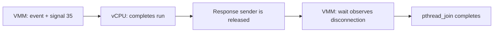

# What happens between the signal and join?

[Português](vcpu-protocol.md) · [Scheduling investigation](vcpu-scheduling.en.md) · [Evidence](../evidence/protocol/index.json) · [Symbols and instructions](../evidence/protocol/symbols.json)

The pressure recorded here was investigated next: [helper memory and clone cache](helper-memory.en.md), with phase measurements, host-load comparison, and retained files.

The previous capture showed signals and thread exit, but not the internal shutdown stages. We now trace the **official v1.17.0 binary**, retaining its one-second deadline, and collect **host WSL2/KVM kernel** stacks. We neither rebuild Firecracker nor replace it with the five-second candidate.

## Stages under investigation

In the pinned source, `shutdown_vcpus` sends `Finish` to each handle. `send_event` queues the event, sets `immediate_exit`, and sends signal 35. The vCPU leaves KVM, processes the event, and completes `run`. Releasing the response sender lets the VMM observe channel disconnection. It then calls `pthread_join` to wait for thread termination.



This is the source-described path. Channel disconnection and kernel thread exit are separate events. A slow join does not necessarily mean a slow response-channel wait; we measure both.

The [probes](../scripts/protocol_points.py) mark entry/return of `send_event`, `recv_timeout`, and handle destruction, the return instruction of `Vcpu::run`, the branch proceeding to `pthread_join`, and instructions immediately before/after that call. The `disconnected` label represents this branch; we decode neither the `Finish` payload nor a Rust `Result` memory layout.

Offsets are accepted only for the exact official binary SHA256. We verify matching executable/debug Build IDs, ELF segments, instruction bytes, and the relocation resolving the call to `pthread_join`. The source archive has a pinned checksum and its one-second timeout is checked. Debug information resolves function names but not detailed Rust lines in this artifact; interior points also use disassembly review. Do not reuse these offsets for another build.

## Collecting without removing the jailer

Every scenario gets its own executable copy inside its jail. Uprobes attach to **that copy's inode**, checked against the running process, and are enabled only in the scenario's tracefs instance. They do not modify executable file bytes on disk. Scheduler, signal, and KVM events retain the discovered vCPU filters. Probe definitions have unique names and are removed individually; we neither truncate `uprobe_events` nor clear unrelated definitions.

During instrumented shutdowns, the trusted helper reads `/proc/<pid>/task/<tid>/stack`, state, and `wchan` for its VM threads, targeting a 5 ms interval. Each read records monotonic start/end times. Actual cadence depends on load. Empty stacks and task-exit read errors remain in the report. State, stack, and `wchan` are sequential reads, not an atomic snapshot: a thread can change state between them.

Correlation labels a main-thread read `response_wait` or `join` only when the complete read fits between that stage's entry/return probes. This associates the observation with the instrumented window; it does not independently identify the futex address or Rust object being waited on.

UID/GID, zero effective capabilities, `NoNewPrivs`, seccomp, namespaces, fresh disks, and jailer limits remain enforced. All observed threads are checked after probe installation and the task-limit test. The trusted helper remains privileged for setup and kernel observation; the VM receives no tracefs access.

Repetitions compare half a CPU and a two-CPU shutdown ceiling, with and without probes. Two unprivileged workers contend on the same host CPUs 6 and 7. Every VM boots, confirms keyboard readiness, runs two guest loops, and exercises the 32-task ceiling by attempting 48 threads. Unprobed controls do not sample stacks. The four-arm order reverses on each repetition, and the wrapper lock prevents simultaneous host-load campaigns from this executor.

## Observed results

The final campaign `jailer-joh82tm9` completed **20/20 shutdowns with exit zero**: ten instrumented runs and ten unprobed controls. All twenty task-limit attempts hit the ceiling: 18 created 25 threads and two created 26 before rejection. The cgroup's 32-task limit remained verified; the created-thread count does not replace reading that limit. Isolation checks passed throughout; there was no panic, helper-local OOM, or forced cleanup. All four original artifacts were unchanged, and cgroups were removed.

Each of the ten instrumented captures contains two send calls, two signal 35 deliveries, two `Vcpu::run` returns, two waits reaching the disconnection branch, two completed joins, and two vCPU exit events. Buffers recorded zero overruns or dropped events. Observed maxima were **5.867 ms inside the response-channel wait call**, **83 µs between the points bracketing `pthread_join`**, and **5.926 ms for one handle's destruction**.

| Shutdown | Minimum / median / maximum, ms | Repetitions |
| --- | --- | --- |
| Half CPU, control | 119.5 / 132.7 / 171.0 | 5 |
| Half CPU, instrumented | 105.0 / 173.1 / 222.6 | 5 |
| Two CPUs, control | 135.7 / 178.4 / 241.2 | 5 |
| Two CPUs, instrumented | 177.9 / 225.1 / 272.8 | 5 |

There were 1,129 attempted stack reads: 1,033 records contain frames, 95 have empty stacks, and two record `FileNotFoundError` during thread exit. These counts are not mutually exclusive: one error occurred after its stack had already been read. None was silently treated as evidence of no kernel activity.

In `half-trace-01`, the complete main-thread read between **343373.064343 and 343373.064702 s** on the monotonic clock fitted inside the response-channel wait. It showed `futex_do_wait → __futex_wait → futex_wait → do_futex`. Other stacks show vCPUs in `kvm_vcpu_block`/`kvm_vcpu_halt` paths. No complete read coincided with the short join window; that reflects sampling cadence, not proof that this stage used no kernel code.

The observed protocol completed every expected stage, but **the delay behind the historical panic did not recur**. Its cause remains unresolved. All **22 automated tests** passed, including rejecting a different binary, missing events, and the thread interleaving that exposed the earlier validator error.

The outer helper cgroup recorded **16,722 `memory.events.local:max` events**, with `oom=0` and `oom_kill=0`. Its memory ceiling came under pressure despite no OOM kill. We did not measure which stage produced each event or isolate their timing impact; this campaign does not represent exclusively CPU contention.

Measurements include observer costs. Uprobes briefly trap execution, and reading stacks consumes CPU. Controls observe exit at 10 ms intervals, while the instrumented arm targets 5 ms. This comparison identifies failures and observed paths on this host; it does not establish a performance improvement.

Stacks in `kvm_vcpu_block`/`kvm_vcpu_halt` can represent normally idle vCPUs, and a futex stack does not establish deadlock. Attributing the historical failure to either wait requires capturing the delay recurring alongside these protocol stages. Successful samples do not guarantee the absence of lost events, deadlocks, or intermittent KVM issues.

## Failed attempts remain available

- `jailer-lwz9nknv`: both controls exited normally; both probe setups failed with `EINVAL` when opening `uprobe_events` in Python append mode. No normal shutdown request followed for those two cases, which required forced cleanup. Secondary collection also returned `EBADF` when writing a marker while tracing was disabled. We now open without `O_APPEND` or `O_TRUNC`, and write the final marker only if tracing is enabled.
- `jailer-4_aesimh`: four clean pilot shutdowns. Both captures contain protocol points and procfs kernel stacks. A `stacktrace` trigger was accepted and appeared in readback, but produced no stack records in the trace. We do not count that configuration as stack capture. The final campaign explicitly uses procfs reads.
- `jailer-2_064uwa`: interrupted campaign, exit 137, without a complete suite report, after finding that the validator confused interleaved vCPU events with main-thread ordering. Raw events remain retained. Validation now checks the sequence per thread, with a regression test covering interleaving.

A later open-mode check showed that raw `os.open` with `O_APPEND` succeeds, whereas Python append-mode opening and `SEEK_END` return `EINVAL`. The failure is therefore attributed to append-mode opening/seeking, not the flag alone. We corrected an overly broad comment and retained the exact executed script. Interrupting `jailer-2_064uwa` left a tracefs instance enabled during discovery; the final check disabled and removed that exact instance name. A forced interruption can bypass `finally`: inspect and clean your own campaign names before repeating.

The final campaign started from a new source snapshot after the correction. Reports distinguish process failure, instrumentation failure, and validator failure.

## Repeat

Prepare the profile as in the [scheduler investigation](vcpu-scheduling.en.md), with `diagnostic_repetitions: 5`, `diagnostic_pid_probe: true`, and `suite_timeout: 600`, retaining the official hashes. Run one campaign at a time:

```bash
python3 scripts/run_jailer_lab.py \
  --suite vcpu_protocol --host-load \
  --profile /path/to/protocol-profile.json \
  --binary-dir /path/to/official-binaries \
  --artifacts /path/to/artifacts \
  --output-parent /path/to/results

python3 scripts/export_protocol_evidence.py \
  --runs /path/to/results/jailer-RUN \
  --output evidence/protocol

python3 -m unittest discover -s tests -v
```

`verify_protocol_symbols.py --help` explains how to repeat the ELF/debug/source archive checks. Local evidence retains traces, raw stacks, consoles, executed source, and disks. Public copies contain stages, timings, stack symbols, limits, and hashes, omitting absolute memory addresses and private contents. Failed attempts remain listed.

References: [uprobes and file offsets](https://docs.kernel.org/trace/uprobetracer.html), [filters and triggers](https://docs.kernel.org/trace/events.html), [protocol in the pinned source](https://github.com/firecracker-microvm/firecracker/blob/95f868c8e345b1cc8faccd1a3c910b4989dc3f58/src/vmm/src/vstate/vcpu.rs).
