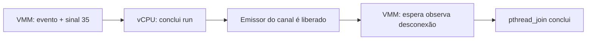

# O que acontece entre o sinal e o join?

[English](vcpu-protocol.en.md) · [Escalonamento](vcpu-scheduling.md) · [Evidências](../evidence/protocol/index.json) · [Símbolos e instruções](../evidence/protocol/symbols.json)

A pressão registrada aqui foi investigada na etapa seguinte: [memória do auxiliar e cache dos clones](helper-memory.md), com medições por etapa, comparação sob carga e preservação dos arquivos.

A captura anterior mostrava sinais e saída das threads, mas não as etapas internas do encerramento. Agora acompanhamos o protocolo no **binário oficial v1.17.0**, com seu prazo de um segundo, e coletamos stacks do **kernel do host WSL2/KVM**. Não recompilamos nem substituímos o Firecracker pela candidata de cinco segundos.

## As etapas que procuramos

No fonte fixado, `shutdown_vcpus` envia `Finish` a cada handle. `send_event` coloca o evento no canal, marca `immediate_exit` e envia o sinal 35. A vCPU sai de KVM, trata o evento e conclui `run`. A liberação do emissor do canal de respostas permite que o VMM observe a desconexão. Só então ele chama `pthread_join` para esperar o término da thread.



Esse é o caminho descrito pelo código; a desconexão do canal e a saída da thread no kernel são eventos diferentes. Um `join` lento não é necessariamente uma espera lenta pelo canal. Separamos as duas medidas.

As [sondas](../scripts/protocol_points.py) marcam entrada/retorno de `send_event`, `recv_timeout` e destruição do handle, o `ret` de `Vcpu::run`, o ramo que prossegue para `pthread_join` e os pontos imediatamente antes/depois dessa chamada. O nome `disconnected` corresponde a esse ramo; não decodificamos o payload de `Finish` nem o layout de um `Result` Rust na memória.

Os offsets só são aceitos para o SHA256 exato do executável oficial. Conferimos o Build ID do executável e dos símbolos de debug, os segmentos ELF, os bytes das instruções e a relocação que resolve a chamada para `pthread_join`. O arquivo de fontes tem checksum fixado e prazo de um segundo conferido. Os símbolos resolvem nomes de funções, mas não linhas Rust detalhadas nesse artefato; a revisão dos pontos internos usa também a desmontagem. Não reutilize os offsets em outro build.

## Como coletamos sem retirar o jailer

Cada cenário recebe uma cópia própria do executável na jail. As uprobes são ligadas ao **inode dessa cópia**, conferido contra o processo em execução, e habilitadas apenas na instância de tracefs do cenário. Elas não modificam os bytes do arquivo em disco. Os eventos de escalonamento, sinais e KVM continuam filtrados pelas vCPUs descobertas no teste anterior. As definições de sondas têm nomes exclusivos e são removidas individualmente; não truncamos `uprobe_events` nem apagamos definições de outros testes.

Durante os encerramentos instrumentados, o auxiliar lê `/proc/<pid>/task/<tid>/stack`, estado e `wchan` das threads da própria VM, com intervalo alvo de 5 ms. Cada leitura registra início e fim no relógio monotônico. O intervalo real depende da carga. Uma stack vazia ou um erro porque a thread já saiu permanece no relatório. Estado, stack e `wchan` vêm de leituras sequenciais, não de um snapshot atômico: uma thread pode mudar de estado entre elas.

A correlação marca `response_wait` ou `join` apenas quando a leitura inteira da thread principal cabe entre as respectivas sondas de entrada e retorno. Isso associa a observação à janela instrumentada; não identifica sozinho qual endereço de futex ou objeto Rust estava sendo esperado.

Mantivemos UID/GID, capacidades de execução zeradas, `NoNewPrivs`, seccomp, namespaces, discos novos por cenário e limites do jailer. A proteção de todas as threads é conferida depois da instalação das sondas e do teste de tarefas. O auxiliar de confiança continua privilegiado para preparar o ambiente e observar o kernel. A VM não recebe acesso a tracefs.

As repetições comparam meia CPU e teto de duas CPUs no encerramento, com e sem sondas. Dois workers sem privilégios disputam as mesmas CPUs 6 e 7 do host. Todas as VMs fazem boot, confirmam o teclado, executam dois loops no guest e exercitam o limite de 32 tarefas com uma tentativa de criar 48 threads. Os controles sem sondas não fazem amostragem de stacks. A ordem dos quatro braços se inverte a cada repetição, e o lock do wrapper impede campanhas simultâneas deste executor.

## O que os testes mostraram

A campanha final `jailer-joh82tm9` teve **20/20 encerramentos com código zero**, dez com instrumentação e dez controles sem sondas. Os vinte testes encontraram o limite de tarefas: 18 criaram 25 threads e dois criaram 26 antes do bloqueio. O teto de 32 tarefas continuou conferido no cgroup; a quantidade criada não substitui essa leitura do limite. Todas as verificações de isolamento passaram; não houve panic, OOM local do auxiliar nem limpeza forçada. Os quatro artefatos originais ficaram intactos e os cgroups foram removidos.

Cada uma das dez capturas instrumentadas tem duas chamadas de envio, duas entregas do sinal 35, dois retornos de `Vcpu::run`, duas esperas que chegam ao ramo de desconexão, dois `join` concluídos e dois eventos de saída de vCPU. Os buffers registraram zero overruns ou eventos descartados. Os valores máximos observados foram **5,867 ms na chamada de espera pelo canal**, **83 µs entre os pontos que cercam `pthread_join`** e **5,926 ms para a destruição de um handle**.

| Encerramento | Mínimo / mediana / máximo, em ms | Repetições |
| --- | --- | --- |
| Meia CPU, controle | 119,5 / 132,7 / 171,0 | 5 |
| Meia CPU, instrumentado | 105,0 / 173,1 / 222,6 | 5 |
| Duas CPUs, controle | 135,7 / 178,4 / 241,2 | 5 |
| Duas CPUs, instrumentado | 177,9 / 225,1 / 272,8 | 5 |

Foram 1.129 tentativas de leitura de stacks: 1.033 registros têm conteúdo, 95 têm stack vazia e dois registram `FileNotFoundError` durante a saída das threads. Essas contagens não são categorias exclusivas: um dos erros ocorreu depois de a stack já ter sido lida. Nada disso foi convertido em stack ausente sem explicação.

Em `half-trace-01`, a leitura da thread principal entre **343373,064343 e 343373,064702 s** do relógio monotônico coube inteiramente na espera pelo canal. Ela mostrou `futex_do_wait → __futex_wait → futex_wait → do_futex`. Também há stacks de vCPU em caminhos `kvm_vcpu_block`/`kvm_vcpu_halt`. Nenhuma leitura inteira coincidiu com a janela curta do `join`; isso é uma limitação da cadência, não prova de que o kernel não foi usado nesse estágio.

O protocolo observado completou todas as etapas esperadas, mas **o atraso que causou o panic histórico não reapareceu**. A causa continua em aberto. Os **22 testes automatizados** passaram, incluindo rejeição de binário diferente, eventos faltantes e a intercalação de threads que expôs o erro anterior do validador.

O cgroup externo do auxiliar registrou **16.722 eventos `memory.events.local:max`**, com `oom=0` e `oom_kill=0`. Houve pressão no teto de memória, mesmo sem morte por OOM. Não medimos em qual etapa cada evento ocorreu nem isolamos seu efeito nos tempos; a campanha não representa contenção exclusivamente de CPU.

As medidas incluem o custo das sondas e da coleta. Uprobes provocam traps breves no processo; ler stacks também consome CPU. O controle usa observação de saída em intervalos de 10 ms, contra alvo de 5 ms no braço instrumentado. A comparação serve para identificar falhas e caminhos observados neste host, não para declarar um ganho de desempenho.

Stacks em `kvm_vcpu_block`/`kvm_vcpu_halt` podem representar uma vCPU normalmente ociosa, e uma stack em `futex` não demonstra deadlock. Só uma recorrência do atraso, correlacionada com o protocolo, permitiria atribuir a falha histórica a uma dessas esperas. Nenhuma garantia geral de ausência de evento perdido, deadlock ou problema intermitente em KVM decorre destes sucessos.

## Falhas da investigação também ficam disponíveis

- `jailer-lwz9nknv`: os dois controles encerraram normalmente; as duas preparações com sondas falharam com `EINVAL` ao abrir `uprobe_events` no modo append do Python. Não houve solicitação normal de shutdown nesses dois cenários, que precisaram de limpeza forçada. A coleta secundária também retornou `EBADF` ao escrever um marcador com a captura desligada. Corrigimos a abertura sem `O_APPEND` e sem `O_TRUNC`, e o fechamento só escreve o marcador se a captura estiver ligada.
- `jailer-4_aesimh`: piloto com quatro encerramentos limpos. As duas capturas têm os pontos do protocolo e stacks via procfs. Um trigger `stacktrace` foi aceito e apareceu no readback, mas não produziu registros de stack no trace. Não contamos essa configuração como captura de stacks. A campanha final usa explicitamente a leitura por procfs.
- `jailer-2_064uwa`: campanha interrompida, saída 137 e sem relatório completo, depois de detectar que o validador confundia eventos intercalados de vCPU com a sequência da thread principal. Os eventos brutos não são descartados. O validador agora verifica a sequência por thread e tem teste de regressão com essa intercalação.

O controle posterior de abertura mostrou que `os.open` com `O_APPEND` funciona, mas o modo append do Python e `SEEK_END` retornam `EINVAL`. Portanto, a falha é atribuída à abertura/posicionamento desse modo, não ao flag isoladamente. Corrigimos também o comentário que era amplo demais, preservando a cópia exata do script executado. A interrupção de `jailer-2_064uwa` deixou uma instância de tracefs ainda ligada na fase de descoberta; ela foi desligada e removida pelo nome exato na verificação final. Esse caso mostra que uma interrupção forçada pode contornar o `finally`: confira e limpe os nomes da própria campanha antes de repetir.

A campanha final começou de um novo snapshot do código depois da correção. Os relatórios distinguem falha do processo, falha da instrumentação e falha do validador.

## Repetir

Prepare o perfil como na [captura de escalonamento](vcpu-scheduling.md), com `diagnostic_repetitions: 5`, `diagnostic_pid_probe: true` e `suite_timeout: 600`, mantendo os hashes oficiais. Execute uma campanha por vez:

```bash
python3 scripts/run_jailer_lab.py \
  --suite vcpu_protocol --host-load \
  --profile /caminho/protocol-profile.json \
  --binary-dir /caminho/binarios-oficiais \
  --artifacts /caminho/artefatos \
  --output-parent /caminho/resultados

python3 scripts/export_protocol_evidence.py \
  --runs /caminho/resultados/jailer-EXECUCAO \
  --output evidence/protocol

python3 -m unittest discover -s tests -v
```

`verify_protocol_symbols.py --help` mostra como refazer a conferência do ELF, debug e arquivo de fontes. As evidências locais retêm traces, stacks brutas, consoles, código executado e discos. A cópia pública inclui etapas, tempos, símbolos das stacks, limites e hashes; omite endereços absolutos de memória e conteúdo privado. As tentativas reprovadas continuam listadas.

Referências: [uprobes e offsets de arquivo](https://docs.kernel.org/trace/uprobetracer.html), [filtros e triggers](https://docs.kernel.org/trace/events.html), [protocolo no fonte fixado](https://github.com/firecracker-microvm/firecracker/blob/95f868c8e345b1cc8faccd1a3c910b4989dc3f58/src/vmm/src/vstate/vcpu.rs).
